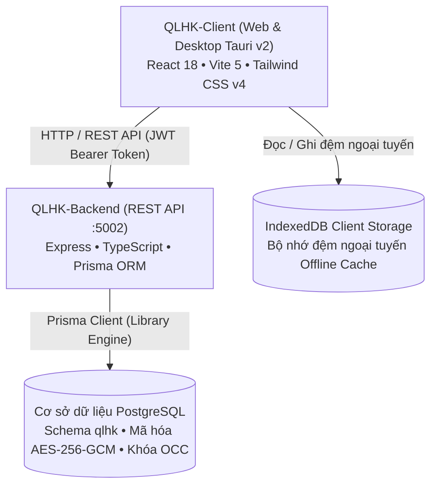

# Quản lý Hộ khẩu & Nhân khẩu — Xã Đăk Hà (QLHK)

Hệ thống số hóa dữ liệu dân cư, quản lý biến động nhân hộ khẩu và thành phần dân tộc phục vụ công tác chỉ đạo, điều hành tại Xã Đăk Hà.


> [!IMPORTANT]
> **Bản quyền thuộc Ủy ban nhân dân Xã Đăk Hà, Huyện Đăk Hà, Tỉnh Kon Tum và Tác giả (Umnuar).**  
> Mọi quyền được bảo lưu. Dự án này là phần mềm nội bộ chuyên dụng, KHÔNG áp dụng giấy phép mã nguồn mở tự do (không dùng MIT, Apache, GPL). Chi tiết xem tại mục [Giấy phép và bản quyền](#8-thong-tin-duy-tri--ban-quyen-phap-ly).

---

## Mục lục

- [1. Tổng quan & Hệ sinh thái số hóa công vụ Xã Đăk Hà](#1-tong-quan--he-sinh-thai-so-hoa-cong-vu-xa-dak-ha)
- [2. Ảnh chụp màn hình](#2-anh-chup-man-hinh)
- [3. Tính năng chính](#3-tinh-nang-chinh)
- [4. Kiến trúc hệ thống & Bảng công nghệ](#4-kien-truc-he-thong--bang-cong-nghe)
- [5. Bắt đầu nhanh](#5-bat-dau-nhanh)
- [6. Cấu trúc thư mục](#6-cau-truc-thu-muc)
- [7. Bảo mật, An toàn thông tin & Giới hạn đã biết](#7-bao-mat-an-toan-thong-tin--gioi-han-da-biet)
- [8. Thông tin duy trì & Bản quyền pháp lý](#8-thong-tin-duy-tri--ban-quyen-phap-ly)

---

## 1. Tổng quan & Hệ sinh thái số hóa công vụ Xã Đăk Hà

**QLHK** là giải pháp phần mềm chuyên dụng phục vụ Cán bộ Tư pháp - Hộ tịch Xã, Ban Chỉ đạo Chuyển đổi số và các Cán bộ Cơ sở (Trưởng thôn/Bí thư chi bộ 8 thôn, làng bản) trên địa bàn xã Đăk Hà, huyện Đăk Hà, tỉnh Kon Tum.

### Bài toán nghiệp vụ thực tiễn tại địa phương:
- **Đối tượng sử dụng**: Cán bộ Tư pháp - Hộ tịch cấp xã (quyền Quản trị viên toàn diện) và Trưởng thôn tại 8 thôn hành chính (quyền Cán bộ Cơ sở phân vùng theo địa bàn).
- **Phạm vi dữ liệu**: Quản lý tập trung 8 thôn đơn vị hành chính, với hơn 513 hộ gia đình và 1.793 nhân khẩu thực tế (hệ thống đã kiểm chứng hiệu năng xử lý mô phỏng trên 23.000+ nhân khẩu), đa dạng thành phần dân tộc thiểu số (Kinh, Xơ Đăng, Ba Na, Gia Rai, Giẻ Triêng, Ê Đê, v.v.).
- **Giá trị công vụ mang lại**:
  - Chuyển dịch toàn diện từ quản lý sổ sách giấy sang cơ sở dữ liệu số hóa tập trung, tra cứu tức thì thông tin nhân khẩu và chủ hộ.
  - Bảo vệ tối đa dữ liệu định danh cá nhân (số Căn cước công dân - CCCD) bằng mật mã học hiện đại, đáp ứng các tiêu chuẩn an toàn thông tin công vụ.
  - Ngăn ngừa xung đột chỉnh sửa đồng thời qua cơ chế khóa lạc quan (OCC), đảm bảo tính toàn vẹn dữ liệu khi nhiều cán bộ cùng truy cập.
  - Tự động hóa khâu tiếp nhận và đối soát tệp dữ liệu Excel biểu mẫu 11 cột, loại bỏ 100% nguy cơ trùng lặp hoặc sai lệch ngày tháng năm sinh.
  - Cung cấp cổng thông tin thống kê dân số đa chiều (Analytics Dashboard) hiển thị trọn vẹn trong một khung nhìn 1080p duy nhất, phục vụ trực tiếp công tác báo cáo chỉ đạo điều hành của Ủy ban nhân dân xã.

### Bảng tham chiếu chéo toàn hệ sinh thái:

| Ứng dụng | Tên đầy đủ | Vai trò chính | Kho lưu trữ |
| :--- | :--- | :--- | :--- |
| **QLCS** | Quản lý Chính sách | Chế độ người cao tuổi, chúc thọ, hưu trí xã hội | [Umnuar/QLCS](https://github.com/Umnuar/QLCS) |
| **QLHK** | Quản lý Hộ khẩu | Dữ liệu dân cư, nhân hộ khẩu, biến động cư trú | [Umnuar/QLHK](https://github.com/Umnuar/QLHK) |
| **QLNN** | Quản lý Nông nghiệp | Quy hoạch 18 chỉ tiêu nông nghiệp, cây trồng, vật nuôi | [Umnuar/QLNN](https://github.com/Umnuar/QLNN) |
| **Unified-Portal** | Cổng Hợp Nhất | Trạm điều phối dịch vụ, giám sát tiến trình và sao lưu | Nội bộ |

---

## 2. Ảnh chụp màn hình

| Danh Sách Hộ Gia Đình & Bung Mở Nhân Khẩu | Cổng Thống Kê Dân Cư & Dân Tộc (Analytics Dashboard) |
| :---: | :---: |
|  |  |
| *Bảng dữ liệu phân cấp, hiển thị chủ hộ và bung mở chi tiết từng nhân khẩu* | *Thống kê 4 KPI đỉnh cao 88px, biểu đồ Donut SVG 176px và cơ cấu tôn giáo/tháp tuổi* |

| Hộp Thoại Nhập Excel 11 Cột & Đối Soát | Quản Trị Địa Bàn 8 Thôn & Chỉ Số Dân Tộc |
| :---: | :---: |
|  |  |
| *Kiểm tra dữ liệu thô, phát hiện CCCD trùng lặp và cảnh báo lỗi trước khi lưu* | *Quản lý phân quyền 8 thôn, tổng hợp số hộ và tỷ lệ đồng bào DTTS* |

---

## 3. Tính năng chính

### 3.1. Quản lý nghiệp vụ chuyên ngành
- **Quản lý hộ gia đình**: Theo dõi thông tin sổ hộ khẩu (`book_number`), phân loại địa bàn theo 8 thôn, tình trạng cư trú (`active` - thường trú, `moved` - đã chuyển đi, `archived` - lưu trữ).
- **Hồ sơ nhân khẩu chi tiết**: Quản lý từng thành viên trong hộ gồm họ tên, quan hệ với chủ hộ, ngày tháng năm sinh (chuẩn hóa định dạng DD/MM/YYYY hoặc YYYY), giới tính, dân tộc, tôn giáo, quê quán, trình độ học vấn, tình hình nghĩa vụ quân sự (NVQS), nghề nghiệp và ghi chú.
- **Bộ lọc đa chiều linh hoạt**:
  - Tra cứu nhanh bằng họ tên tiếng Việt có dấu hoặc không dấu (`name_unaccented`), số CCCD (đối soát băm SHA-256).
  - Lọc phân tầng theo thôn, mốc năm tính toán, khoảng tuổi nghiệp vụ chuyên sâu (`AgeFilterPopover`: Dưới 16 tuổi, Độ tuổi NVQS 18–27, Tuổi lao động 18–60, Người cao tuổi trên 60), giới tính và thành phần dân tộc.
- **Thùng rác & Phục hồi dữ liệu**: Cơ chế xóa mềm (`is_deleted`, `deleted_at`) ở cả cấp hộ và cấp nhân khẩu; hỗ trợ tra cứu lịch sử và khôi phục nguyên trạng kèm ràng buộc toàn vẹn.

### 3.2. Xử lý dữ liệu & Bảng tính
- **Nhập dữ liệu Excel thông minh**:
  - Tự động nhận diện cấu trúc tệp Excel thực tế Đăk Hà và biểu mẫu chuẩn 11 cột phẳng.
  - Hộp thoại xem trước đối soát (`ImportPreviewModal`): Tự động kiểm tra tính hợp lệ của từng dòng, cảnh báo lỗi ngày sinh không đúng quy cách, phát hiện trùng lặp số CCCD ngay trên giao diện trước khi cam kết ghi vào CSDL.
- **Xuất báo cáo bảng tính đa năng (`ExportSettingsModal`)**:
  - Tab 1: Xuất nhanh theo biểu mẫu chuẩn 11 cột phục vụ hành chính công.
  - Tab 2: Tùy biến linh hoạt bộ lọc độ tuổi, tiêu chí thống kê và lựa chọn xuất lên đến 16 cột dữ liệu chi tiết.
  - Cơ chế làm sạch dữ liệu (`sanitizeExcelRow`): Tự động vô hiệu hóa các ký tự độc hại (`=`, `+`, `-`, `@`), triệt tiêu hoàn toàn lỗ hổng chèn mã công thức Formula Injection (CWE-1236).

### 3.3. Bảo mật & Kiểm soát truy cập
- **Mã hóa CCCD bằng AES-256-GCM**: Dữ liệu số CCCD được mã hóa đối xứng ở tầng máy chủ trước khi lưu vào CSDL (`iv:authTag:encryptedHex`).
- **Mã băm tra cứu an toàn (`cccd_hash`)**: Ứng dụng mã băm một chiều SHA-256 kết hợp chuỗi khóa bảo mật (`CCCD_HASH_PEPPER`) để tra cứu đối soát chính xác tuyệt đối mà không cần giải mã dữ liệu hàng loạt.
- **Che mờ thông tin cá nhân (Masking)**: Mặc định chỉ hiển thị 4 số cuối của CCCD (`cccd_last4`) trên bảng dữ liệu; thao tác mở xem CCCD thô yêu cầu quyền hạn và được ghi nhận vào nhật ký kiểm toán.
- **Phân quyền vai trò nghiêm ngặt (RBAC)**:
  - *Quản trị viên Xã (`admin`)*: Toàn quyền truy cập dữ liệu toàn xã, quản lý người dùng, phân công thôn và sao lưu hệ thống.
  - *Cán bộ Cơ sở (`user`)*: Bị giới hạn phạm vi truy cập nghiêm ngặt trong ranh giới `village_id` được phân công.
- **Khóa lạc quan (Optimistic Concurrency Control - OCC)**: Sử dụng trường phiên bản `version` tăng tự động trong giao dịch ACID, ngăn chặn triệt để hiện tượng ghi đè dữ liệu ngầm khi có nhiều cán bộ đồng thời thao tác trên cùng một hộ.

### 3.4. Quản trị & Báo cáo
- **Cổng thống kê dân cư chuẩn mực (Analytics Dashboard)**:
  - Thiết kế theo chuẩn giao diện v0 (1), hiển thị trọn vẹn 100% trong một khung màn hình 1080p (~700px chiều cao) không cuộn trang.
  - 4 thẻ KPI chuẩn chiều cao 88px viền màu trên đỉnh (Tổng Hộ, Tổng Nhân Khẩu, Tỷ Lệ DTTS, Cơ Cấu Giới Tính).
  - Biểu đồ Donut SVG 176px với cơ chế Hit-Target chống trượt chuột (`MIN_HIT_LENGTH = 16`), làm mờ dải không chọn (opacity 0.3), đồng bộ hover 2 chiều và nhãn tâm tiếng Việt đầy đủ ("Dân tộc thiểu số", "Người có tôn giáo", "Trong độ tuổi lao động").
  - Phân tích chi tiết 2 cột tình hình Nghĩa vụ quân sự và Trình độ học vấn / Cơ cấu nghề nghiệp kèm huy hiệu trạng thái.
- **Lưu trữ ngoại tuyến (Offline-First Cache)**: Tích hợp IndexedDB phía Client, tự động lưu trữ đệm dữ liệu thống kê và danh mục; tự động chuyển sang chế độ ngoại tuyến có huy hiệu nhận diện khi mất kết nối mạng.
- **Nhật ký kiểm toán toàn diện (Audit Logs)**: Ghi vết chi tiết mọi hành vi `CREATE`, `UPDATE`, `DELETE`, `RESTORE`, `IMPORT` kèm thông tin cán bộ, địa chỉ IP và ảnh chụp dữ liệu trước/sau biến động (`old_values`, `new_values`).

---

## 4. Kiến trúc hệ thống & Bảng công nghệ

### 4.1. Sơ đồ kiến trúc luồng dữ liệu



### 4.2. Bảng chi tiết phiên bản công nghệ thực tế

| Phân hệ / Thành phần | Công nghệ sử dụng | Phiên bản thực tế | Mục đích sử dụng |
| :--- | :--- | :--- | :--- |
| **Giao diện người dùng** | React | `^18.2.0` | Thư viện xây dựng giao diện người dùng phân tử |
| | React Router DOM | `^7.15.0` | Điều hướng định tuyến ứng dụng Single Page App |
| | Tailwind CSS | `^4.2.4` | Framework CSS nguyên tử hóa hiện đại |
| | Lucide React | `^1.14.0` | Bộ biểu tượng giao diện công vụ chuẩn hóa |
| **Nền tảng Desktop** | Tauri v2 | `@tauri-apps/api ^2.2.0` | Nhân Thin-Client Desktop bảo mật cao bằng Rust |
| | Tauri CLI | `@tauri-apps/cli ^2.2.0` | Công cụ đóng gói bộ cài Windows (.msi, .exe) |
| **Công cụ phát triển Client** | Vite | `^5.1.6` | Trình đóng gói và máy chủ phát triển siêu tốc |
| | TypeScript | `^5.2.2` | Hệ thống kiểm tra kiểu dữ liệu tĩnh phía Client |
| **Xử lý Bảng tính** | SheetJS (xlsx) | `^0.18.5` | Bóc tách và xuất file Excel phía Client |
| | ExcelJS | `^4.4.0` | Xử lý tệp bảng tính đa luồng phía Backend |
| **Máy chủ API Backend** | Node.js | `>= 20.0.0` | Môi trường thực thi JavaScript phía máy chủ |
| | Express | `^4.21.2` | Khung ứng dụng máy chủ RESTful API |
| | TypeScript | `^5.7.2` | Ngôn ngữ phát triển máy chủ hướng đối tượng và type-safe |
| | tsx | `^4.19.2` | Trình thực thi TypeScript trực tiếp trong môi trường DEV |
| **Cơ sở dữ liệu & ORM** | PostgreSQL | `>= 15.0` | Hệ quản trị CSDL quan hệ chính (Schema `qlhk`) |
| | Prisma ORM | `@prisma/client ^6.0.0` | Trình ánh xạ quan hệ đối tượng (ORM) thế hệ mới |
| **Bảo mật & Mật mã** | Crypto (Native Node) | `AES-256-GCM` | Thuật toán mã hóa đối xứng số CCCD |
| | jsonwebtoken | `^9.0.2` | Ký và xác thực Access Token & Refresh Token |
| | bcryptjs | `^2.4.3` | Băm mật khẩu người dùng với muối an toàn |
| | Helmet | `^8.0.0` | Thiết lập tiêu đề bảo mật HTTP phòng chống tấn công |
| | Zod | `^3.24.1` | Thư viện xác thực lược đồ dữ liệu API đầu vào |
| **Tác vụ & Hạ tầng** | node-cron | `^3.0.3` | Tự động hóa snapshot sao lưu dữ liệu định kỳ |
| | compression | `^1.8.1` | Nén luồng dữ liệu HTTP Gzip/Brotli giảm tải băng thông |
| **Kiểm thử tự động** | Vitest (Backend) | `^2.1.8` | Khung kiểm thử tích hợp, bảo mật và hiệu năng Backend |
| | Vitest (Client) | `^4.1.11` | Khung kiểm thử đơn vị, component và luồng người dùng |
| | Supertest | `^7.0.0` | Kiểm thử tích hợp điểm cuối HTTP API End-to-End |
| | Playwright | `^1.64.0` | Kiểm thử trình duyệt tự động E2E |

---

## 5. Bắt đầu nhanh

### 5.1. Yêu cầu môi trường
- **Node.js**: Phiên bản `>= 20.0.0` (Khuyến nghị phiên bản LTS 20 hoặc 22).
- **npm**: Phiên bản `>= 10.0.0`.
- **Cơ sở dữ liệu PostgreSQL**: Phiên bản `>= 15.0` (hỗ trợ tiện ích mở rộng `pg_trgm` và `uuid-ossp`).
- **Rust Toolchain**: (Tùy chọn) Bắt buộc nếu cần đóng gói bộ cài Desktop qua Tauri v2.

### 5.2. Cài đặt mã nguồn

```bash
# 1. Tải kho lưu trữ về máy trạm
git clone https://github.com/Umnuar/QLHK.git
cd QLHK

# 2. Cài đặt phân hệ Backend
cd QLHK-Backend
npm install
cp .env.example .env

# 3. Cài đặt phân hệ Client
cd ../QLHK-Client
npm install
cp .env.example .env
```

### 5.3. Cấu hình biến môi trường

#### Cấu hình Máy chủ (`QLHK-Backend/.env`):

| Tên biến | Kiểu giá trị | Mặc định | Ý nghĩa & Mô tả | Bắt buộc |
| :--- | :--- | :--- | :--- | :---: |
| `PORT` | Number | `5002` | Cổng mạng TCP máy chủ API lắng nghe | Không |
| `NODE_ENV` | String | `development` | Môi trường vận hành (`development` / `production` / `test`) | Không |
| `DATABASE_URL` | String (URI) | — | Chuỗi kết nối PostgreSQL (Session mode, schema `qlhk`) | **Có** |
| `DIRECT_URL` | String (URI) | — | Chuỗi kết nối trực tiếp PostgreSQL dùng để migrate/push | **Có** |
| `JWT_SECRET` | String | — | Khóa bí mật ký Access Token (tối thiểu 32 ký tự ngẫu nhiên) | **Có** |
| `JWT_REFRESH_SECRET` | String | — | Khóa bí mật ký Refresh Token (tối thiểu 32 ký tự ngẫu nhiên) | **Có** |
| `ENCRYPTION_KEY` | Hex (64 ký tự) | — | Khóa đối xứng 256-bit mã hóa AES-256-GCM cho số CCCD | **Có** |
| `CCCD_HASH_PEPPER` | String | — | Khóa bí mật (pepper) dùng băm một chiều SHA-256 đối soát CCCD | **Có** |
| `EXCEL_SAMPLE_PATH` | Path | `./Nhân hộ khẩu.xls` | Đường dẫn tệp bảng tính mẫu nhân hộ khẩu Đăk Hà | Không |
| `CORS_ORIGIN` | String | — | Danh sách nguồn gốc cho phép kết nối CORS qua API | Không |

#### Cấu hình Giao diện (`QLHK-Client/.env`):

| Tên biến | Kiểu giá trị | Mặc định | Ý nghĩa & Mô tả | Bắt buộc |
| :--- | :--- | :--- | :--- | :---: |
| `VITE_API_URL` | String (URL) | `https://qlhk.dulieudakha.vn/api` | Đường dẫn endpoint API kết nối tới máy chủ Backend | **Có** |

> [!TIP]
> Khi phát triển ở môi trường cục bộ (DEV), có thể cấu hình `VITE_API_URL=http://localhost:5002/api` hoặc sử dụng proxy nội bộ Vite `/api` để tránh lỗi CORS.

### 5.4. Đồng bộ cơ sở dữ liệu & Khởi tạo dữ liệu mẫu

```bash
cd QLHK-Backend

# Sinh mã Prisma Client tương ứng với hệ CSDL
npm run prisma:generate

# Cập nhật cấu trúc bảng vào PostgreSQL (schema qlhk)
npm run prisma:push

# Nạp dữ liệu tài khoản quản trị và danh mục 8 thôn hành chính
npm run seed:admin

# (Tùy chọn) Nạp bộ dữ liệu thử nghiệm 513 hộ và 1.793 nhân khẩu
npm run seed
```

### 5.5. Khởi chạy ứng dụng trong môi trường phát triển

```bash
# Cửa sổ dòng lệnh 1: Khởi chạy máy chủ Backend (Cổng lắng nghe :5002)
cd QLHK-Backend
npm run dev

# Cửa sổ dòng lệnh 2: Khởi chạy giao diện Web Client (Cổng lắng nghe :5175)
cd QLHK-Client
npm run dev

# Cửa sổ dòng lệnh 3 (Tùy chọn): Khởi chạy ứng dụng Desktop Tauri v2
cd QLHK-Client
npm run tauri:dev
```

### 5.6. Kiểm thử tự động (Verification & Quality Gates)

Hệ thống duy trì quy trình kiểm thử nghiêm ngặt với **270/270 bài test tự động PASS tuyệt đối (100%)**:

```bash
# 1. Kiểm thử phân hệ Backend (115 bài kiểm thử)
cd QLHK-Backend
npm test
# Kết quả thực tế: 7 test files passed, 115 tests passed (100%)
# Kiểm tra an toàn kiểu dữ liệu tĩnh:
npx tsc --noEmit  # Trả về mã thoát 0 (0 lỗi)

# 2. Kiểm thử phân hệ Client (155 bài kiểm thử)
cd QLHK-Client
npm test -- --run
# Kết quả thực tế: 17 test files passed, 155 tests passed (100%)
# Kiểm tra an toàn kiểu dữ liệu tĩnh:
npx tsc --noEmit  # Trả về mã thoát 0 (0 lỗi)
```

### 5.7. Đóng gói phát hành ứng dụng

```bash
cd QLHK-Client

# 1. Đóng gói bản phát hành Web Production
npm run build:vite
# Đầu ra: Thư mục QLHK-Client/dist/ sẵn sàng triển khai trên Nginx/Cloudflare Pages

# 2. Đóng gói bộ cài đặt Windows Desktop (.exe / .msi) qua Tauri v2
npm run tauri:build
# Đầu ra: Thư mục QLHK-Client/src-tauri/target/release/bundle/msi/
```

---

## 6. Cấu trúc thư mục

Cấu trúc dự án được thiết kế phân tầng mạch lạc theo tiêu chuẩn doanh nghiệp:

```
QLHK/
├── QLHK-Backend/               # Dịch vụ máy chủ REST API & Cơ sở dữ liệu (:5002)
│   ├── prisma/                 # Lược đồ quan hệ PostgreSQL (schema.prisma, extensions)
│   ├── scripts/                # Kịch bản khởi tạo CSDL (seed.ts, seed-admin.ts)
│   ├── src/                    # Mã nguồn TypeScript Backend
│   │   ├── config/             # Cấu hình biến môi trường và Logger chuẩn 1 dòng
│   │   ├── controllers/        # Điều phối nghiệp vụ (households, citizens, analytics, auth, users, backup)
│   │   ├── middlewares/        # Kiểm soát quyền hạn (RBAC), xác thực JWT và bảo mật
│   │   ├── routes/             # Định tuyến API (/api/households, /api/analytics, /api/auth, v.v.)
│   │   └── utils/              # Tiện ích mã hóa AES-256-GCM, băm SHA-256, parse Excel, chống Formula Injection
│   └── tests/                  # Bộ 115 bài kiểm thử tích hợp API, unit test, benchmark và OCC
├── QLHK-Client/                # Phân hệ Giao diện Người dùng (Web & Windows Desktop)
│   ├── public/                 # Biểu tượng công vụ, favicon và tài nguyên tĩnh
│   ├── src-tauri/              # Cấu hình nhân native Desktop Tauri v2 (Rust, permissions, icons)
│   ├── src/                    # Mã nguồn React 18, Vite và Tailwind CSS v4
│   │   ├── api/                # Lớp giao tiếp mạng Axios (households, analytics, auth, users, villages)
│   │   ├── components/         # Thư viện thành phần giao diện chuyên dụng
│   │   │   ├── analytics/      # Dashboard v0 (1) SVG 176px, DonutChart, WelfareCard, KpiRow
│   │   │   ├── common/         # CustomSelect, statStyles, tableStyles, ThemeToggle
│   │   │   ├── excel/          # Modal xem trước nhập Excel, Modal cấu hình xuất 16 cột
│   │   │   └── households/     # Bảng hộ gia đình, Drawer chi tiết, Modal nhân khẩu
│   │   ├── context/            # Quản lý trạng thái toàn cục (HouseholdContext, AppContext)
│   │   ├── db/                 # Lưu trữ ngoại tuyến qua IndexedDB (Offline Cache)
│   │   ├── pages/              # Các màn hình chính (Households, Analytics, Villages, Settings)
│   │   └── utils/              # Tiện ích che mờ CCCD, tách họ tên, chuẩn hóa ngày tháng
│   └── tests/                  # Bộ 155 bài kiểm thử Vitest giao diện, component và luồng E2E
├── docs/                       # Tài liệu kỹ thuật, kiến trúc hệ thống và kiểm định chất lượng
│   ├── engineering-audit/      # Báo cáo đánh giá chất lượng mã nguồn, bảo mật, hiệu năng
│   ├── qa/                     # Kết quả kiểm thử trình duyệt thực tế và danh mục luồng người dùng
│   └── security/               # Mô hình mối đe dọa (Threat Model) và tài liệu SAST/DAST
├── qlhk_document.md            # Tài liệu đặc tả yêu cầu nghiệp vụ quản lý nhân hộ khẩu
├── SECURITY.md                 # Chính sách an toàn thông tin và quy trình ứng phó sự cố
└── README.md                   # Tài liệu hướng dẫn sử dụng và triển khai chuẩn mực v1.5.0
```

---

## 7. Bảo mật, An toàn thông tin & Giới hạn đã biết

### 7.1. Chính sách bảo mật & An toàn thông tin
- **Bảo vệ dữ liệu công dân**: Áp dụng nghiêm ngặt nguyên tắc chỉ lưu trữ số CCCD dưới dạng mật mã đối xứng AES-256-GCM. Không bao giờ hiển thị toàn bộ số CCCD trong danh sách trừ khi có thao tác chủ động xem của cán bộ có thẩm quyền.
- **Phòng chống tấn công bảng tính (CWE-1236)**: Toàn bộ dữ liệu xuất ra tệp Excel đều được xử lý qua hàm `sanitizeExcelRow` để loại bỏ các ký tự khởi đầu công thức độc hại.
- **Bảo vệ phiên làm việc**: Cơ chế xác thực hai lớp với Access Token (hạn 15 phút) và Refresh Token (hạn 7 ngày) được quản lý lưu trữ trong CSDL, cho phép thu hồi phiên tức thì khi phát hiện dấu hiệu bất thường.
- **Nhật ký kiểm toán không thể xóa bỏ (Audit Trail)**: Mọi thao tác thêm mới, hiệu chỉnh, xóa hoặc khôi phục nhân khẩu đều được tự động lưu vết kèm địa chỉ IP máy trạm và giá trị dữ liệu sai khác.

> [!NOTE]
> Chi tiết về chính sách an toàn thông tin, quy trình tiếp nhận và báo cáo lỗ hổng bảo mật vui lòng xem tại [SECURITY.md](SECURITY.md).

### 7.2. Trạng thái vận hành & Giới hạn đã biết
- **Trạng thái thực tế**: Hệ thống đang vận hành ổn định phục vụ số hóa và quản lý dân cư thực tế trên địa bàn 8 thôn thuộc Xã Đăk Hà.
- **Giới hạn đã biết**:
  - Danh mục thôn và các tài khoản cán bộ thôn cần được khởi tạo trước trong CSDL thông qua kịch bản hạt giống hoặc trang cài đặt quản trị.
  - Khi triển khai Desktop qua Tauri v2 trên Windows, máy trạm cần cài đặt sẵn môi trường WebView2 Runtime (mặc định đã có trên Windows 10/11).
- **Lộ trình nâng cấp tiếp theo**:
  - Tích hợp đồng bộ dữ liệu thời gian thực hai chiều với hệ sinh thái Cổng Hợp Nhất (Unified-Portal) và phân hệ Quản lý Chính sách (QLCS).
  - Nghiên cứu cơ chế ký số điện tử trên các báo cáo thống kê nhân hộ khẩu xuất bản.

---

## 8. Thông tin duy trì & Bản quyền pháp lý

### 8.1. Đơn vị duy trì & Tiếp nhận kỹ thuật
- **Đơn vị quản lý**: Ban Chỉ đạo Chuyển đổi số Ủy ban nhân dân Xã Đăk Hà.
- **Địa bàn hành chính**: Xã Đăk Hà, Huyện Đăk Hà, Tỉnh Kon Tum.
- **Tác giả phát triển**: [Umnuar (GitHub)](https://github.com/Umnuar).
- **Kênh tiếp nhận kỹ thuật**: `baotruongminh201@gmail.com`.

### 8.2. Giấy phép và bản quyền

Toàn bộ mã nguồn, cấu trúc dữ liệu, giao diện người dùng và tài liệu kỹ thuật liên quan của dự án **Quản lý Hộ khẩu & Nhân khẩu Xã Đăk Hà (QLHK)** thuộc quyền sở hữu trí tuệ độc quyền của **Ủy ban nhân dân Xã Đăk Hà, Huyện Đăk Hà, Tỉnh Kon Tum** và **Tác giả (Umnuar)**.

Mọi quyền được bảo lưu (All Rights Reserved). Dự án này là phần mềm chuyên dụng nội bộ phục vụ công vụ chính quyền địa phương, **KHÔNG áp dụng bất kỳ giấy phép mã nguồn mở tự do nào (không áp dụng MIT, Apache, GPL hoặc tương đương)**.

Nghiêm cấm mọi hành vi sao chép, chỉnh sửa, trích xuất, đảo ngược mã nguồn, phân phối lại hoặc sử dụng vào mục đích thương mại dưới bất kỳ hình thức nào khi chưa có sự đồng ý chính thức bằng văn bản từ đại diện có thẩm quyền của Ủy ban nhân dân Xã Đăk Hà.