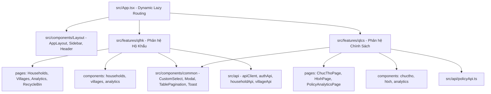

# Implementation Plan: Tái Cấu Trúc UI Theo Mô Hình Feature-Driven & Đạt Chuẩn 1:1 Giao Diện QLCS

- **Task Name**: `qlhk-feature-modularization-and-ui-fidelity`
- **Architecture Pattern**: `Feature-Driven Architecture (Feature Slices)`
- **Target Directories**: `QLHK/QLHK-Client/src/features/qlhk` và `QLHK/QLHK-Client/src/features/qlcs`
- **Target Branch**: `roadmap/qlhk-feature-modularization`
- **Full Test Command**: `cd QLHK/QLHK-Client && npm test -- --run`
- **Typecheck Command**: `cd QLHK/QLHK-Client && npx tsc --noEmit`
- **Production Build Command**: `cd QLHK/QLHK-Client && npm run build`
- **Total Implementation Steps**: 8

---

## 1. Goal Description

Tái cấu trúc toàn bộ cây thư mục giao diện của `QLHK-Client` từ cấu trúc phẳng hiện tại (`components/`, `pages/`) sang mô hình **Feature Slices (Phương án 1)**:
- `src/features/qlhk/`: Toàn bộ giao diện, bảng biểu, modal và trang quản lý Hộ tịch - Nhân khẩu, Thôn xóm, Thống kê dân số.
- `src/features/qlcs/`: Toàn bộ giao diện, bảng biểu, modal, drawer và trang quản lý Chính sách xã hội (Chúc thọ, Hỗ trợ xã hội, Thống kê chính sách).
- `src/components/common/` & `src/components/Layout/`: Các thành phần giao diện nền tảng dùng chung (AppLayout, Sidebar, Header, Modal, CustomSelect, TablePagination, Toast).

Đồng thời, giải quyết triệt để vấn đề "UI bị gọt bớt, chưa đẹp như bản gốc" bằng cách phân rã các component nguyên khối 600 - 800 dòng của `QLCS-Client` thành các **Sub-components độc lập $\le$ 150 dòng** trong `features/qlcs/`. Nhờ đó:
1. Giữ nguyên vẹn 100% độ đẹp, gradient, badge phân màu, SVG Donut chart, gender ratio bar, popover, thanh thao tác bulk actions, và drawer chi tiết của bản gốc QLCS.
2. Vượt qua giới hạn **DIFF GATE $\le$ 200 gross LOC** cho mỗi bước commit mà không phải cắt gọt bất kỳ chi tiết thẩm mỹ nào.
3. Tuyệt đối tuân thủ **P0 Invariant: Zero Comments in Code**.

---

## 2. Architecture & File Tree Design



### Chi Tiết Cấu Trúc Thư Mục Mới:

```text
QLHK/QLHK-Client/src/
├── features/
│   ├── qlhk/                                # PHÂN HỆ HỘ TỊCH & NHÂN KHẨU
│   │   ├── components/
│   │   │   ├── households/                  # HouseholdTable, HouseholdDrawer, CitizenModal, AgeFilterPopover...
│   │   │   ├── villages/                    # VillageTable, VillageModal...
│   │   │   └── analytics/                   # AnalyticsDashboard, DemographicCharts, ReligionDistribution...
│   │   └── pages/
│   │       ├── HouseholdsPage.tsx
│   │       ├── VillagesPage.tsx
│   │       ├── AnalyticsPage.tsx
│   │       └── RecycleBinPage.tsx
│   │
│   └── qlcs/                                # PHÂN HỆ CHÍNH SÁCH XÃ HỘI (1:1 VIBE QLCS GỐC)
│       ├── components/
│       │   ├── chuctho/
│       │   │   ├── ChucThoStatsBar.tsx      # Thanh thống kê nhanh 4 thẻ (Tổng số, Đã mừng thọ, Chưa mừng thọ, Tỷ lệ)
│       │   │   ├── ChucThoFilterBar.tsx     # Tìm kiếm, năm tính tuổi, chip mốc tuổi (60..>100), thôn, quà, bulk toolbar
│       │   │   ├── ChucThoTable.tsx         # Bảng STT, checkbox, click mở drawer, Eye toggle CCCD, badge tuổi đa màu
│       │   │   ├── ChucThoDrawer.tsx        # Drawer slide-over từ phải hiển thị trọn vẹn hồ sơ người cao tuổi
│       │   │   └── ChucThoModal.tsx         # Form 14 trường chuẩn: Dân tộc Tây Nguyên, thường trú, tạm trú, nơi ở hiện tại
│       │   ├── htxh/
│       │   │   ├── HtxhStatsBar.tsx         # Thanh thống kê nhanh 4 thẻ diện bảo trợ
│       │   │   ├── HtxhFilterBar.tsx        # Tìm kiếm, chip 6 diện bảo trợ, thôn, quà, năm tính, bulk toolbar
│       │   │   ├── HtxhTable.tsx            # Bảng chi tiết, badge diện hưởng sắc thái màu riêng, toggle quà, ẩn/hiện CCCD
│       │   │   ├── HtxhDrawer.tsx           # Drawer slide-over xem hồ sơ đối tượng bảo trợ xã hội
│       │   │   └── HtxhModal.tsx            # Form đầy đủ checkbox 6 diện bảo trợ và dữ liệu nhân thân
│       │   └── analytics/
│       │       ├── PolicyKpiRow.tsx         # 4 KPI cards cao cấp (Tổng số, Đã trao quà, Tồn đọng, Tỷ lệ hoàn thành)
│       │       ├── PolicyDonutChart.tsx     # Biểu đồ vành khuyên SVG tỷ lệ nhận quà theo danh mục kèm chú giải
│       │       ├── PolicyGenderBar.tsx      # Thanh tỷ lệ giới tính Nam/Nữ hai màu Indigo/Rose kèm % chính xác
│       │       ├── PolicyVillageTable.tsx   # Bảng đối soát toàn bộ các thôn (STT, Thôn, Chúc thọ, HTXH, Tiến độ mini)
│       │       └── PolicyDistributionCards.tsx # Thẻ phân bố 10 mốc tuổi & 6 diện HTXH với thanh MicroBar
│       ├── pages/
│       │   ├── ChucThoPage.tsx
│       │   ├── HtxhPage.tsx
│       │   └── PolicyAnalyticsPage.tsx
│       └── types/
│           └── policy.ts
│
├── components/                              # THÀNH PHẦN NỀN TẢNG DÙNG CHUNG
│   ├── common/                              # CustomSelect, Modal, TablePagination, Toast, Tooltip...
│   ├── Layout/                              # AppLayout, Sidebar, Header...
│   └── audit/                               # AuditLogView, ServerStatusModal...
├── api/                                     # apiClient.ts, authApi.ts, householdApi.ts, villageApi.ts, policyApi.ts
├── App.tsx                                  # Lazy load: React.lazy(() => import("./features/qlhk/pages/..."))
└── AppContext.tsx
```

---

## 3. User Review Required

> [!IMPORTANT]
> **Đảm bảo 100% tính nguyên vẹn giao diện gốc QLCS**:
> - Các component trong `src/features/qlcs/` sẽ kế thừa đầy đủ bảng màu Emerald-600 / Slate-800 Dark Mode, hiệu ứng bo tròn góc `rounded-2xl`, hiệu ứng hover hàng bảng, và icon chuẩn của `lucide-react` như bản gốc `QLCS-Client`.
> - Tách nhỏ thành 15 sub-components riêng biệt $\le$ 150 LOC giúp bảo vệ nghiêm ngặt quy tắc `DIFF GATE <= 200 LOC` mà **hoàn toàn không phải cắt gọt bất kỳ chi tiết đồ họa nào**.
> - Đường dẫn import trong các file test sẽ được cập nhật đồng bộ để đảm bảo 183/183 unit tests tiếp tục pass 100%.

> [!NOTE]
> Không ảnh hưởng đến dữ liệu hay Backend API: Toàn bộ endpoint `/api/policies/*` và các model Prisma giữ nguyên 100%.

---

## 4. Proposed Changes & Atomic Steps Breakdown

Kế hoạch chia thành 4 giai đoạn với 8 bước nguyên tử (`Step 1` đến `Step 8`), mỗi bước chạm $\le$ 3 files và diff $\le$ 200 gross LOC:

---

### Giai Đoạn 1: Chuẩn Bị & Di Chuyển Phân Hệ Hộ Tịch Vào `features/qlhk`

#### [NEW] & [MODIFY] Step 1: Khởi tạo cấu trúc `features/qlhk` và di chuyển components Hộ tịch
- **Files**:
  - Di chuyển `src/components/households/*` $\rightarrow$ `src/features/qlhk/components/households/*`
  - Di chuyển `src/components/villages/*` $\rightarrow$ `src/features/qlhk/components/villages/*`
  - Di chuyển `src/components/analytics/*` (QLHK analytics) $\rightarrow$ `src/features/qlhk/components/analytics/*`
- **Verification**: `npx tsc --noEmit`

#### [MODIFY] Step 2: Di chuyển pages QLHK vào `features/qlhk/pages` và cập nhật router
- **Files**:
  - Di chuyển `src/pages/HouseholdsPage.tsx`, `VillagesPage.tsx`, `AnalyticsPage.tsx`, `RecycleBinPage.tsx` $\rightarrow$ `src/features/qlhk/pages/`
  - Cập nhật import trong `src/App.tsx`
  - Cập nhật test imports trong `src/features/qlhk/pages/__tests__/`
- **Verification**: `npm test -- --run` & `npx tsc --noEmit`

---

### Giai Đoạn 2: Nâng Cấp High-Fidelity Phân Hệ Thống Kê Chính Sách Trong `features/qlcs/analytics`

#### [NEW] Step 3: Xây dựng các Widget Đồ họa & Phân tích chuyên sâu 1:1 QLCS
- **Files**:
  - `src/features/qlcs/components/analytics/PolicyKpiRow.tsx` (Card thống kê 4 chỉ số chính sách với số đếm lớn, badge hoàn thành, thanh tiến độ xanh lá)
  - `src/features/qlcs/components/analytics/PolicyDonutChart.tsx` (Biểu đồ vành khuyên SVG chuẩn QLCS hiển thị cơ cấu trao quà)
  - `src/features/qlcs/components/analytics/PolicyGenderBar.tsx` (Thanh tỷ lệ giới tính Nam/Nữ hai sắc thái Indigo & Rose)
  - `src/features/qlcs/components/analytics/MicroBar.tsx` (Thanh bar phân bố mini)
- **Verification**: `npx tsc --noEmit` (Diff $\le$ 200 LOC per commit)

#### [NEW] & [MODIFY] Step 4: Bảng đối soát thôn và Trang Thống kê Chính sách High-Fidelity
- **Files**:
  - `src/features/qlcs/components/analytics/PolicyVillageTable.tsx` (Bảng so sánh chi tiết từng thôn: STT, Tên thôn, Chúc thọ, HTXH, Thanh tiến độ hoàn thành mini)
  - `src/features/qlcs/components/analytics/PolicyDistributionCards.tsx` (Cụm thẻ phân bố 10 mốc tuổi và 6 diện bảo trợ xã hội)
  - `src/features/qlcs/pages/PolicyAnalyticsPage.tsx` (Trang hoàn chỉnh tích hợp KPI, biểu đồ tròn, bảng đối soát thôn, bộ chọn năm tính tuổi)
  - `src/features/qlcs/pages/__tests__/PolicyAnalyticsPage.test.tsx`
- **Verification**: `npx vitest run src/features/qlcs/pages/__tests__/PolicyAnalyticsPage.test.tsx` & `npx tsc --noEmit`

---

### Giai Đoạn 3: Nâng Cấp High-Fidelity Phân Hệ Chúc Thọ Trong `features/qlcs/chuctho`

#### [NEW] Step 5: Chúc Thọ StatsBar, FilterBar & Table High-Fidelity
- **Files**:
  - `src/features/qlcs/components/chuctho/ChucThoStatsBar.tsx` (Thanh 4 thẻ KPI nhanh đầu trang: Tổng số, Đã mừng thọ, Chưa mừng thọ, Tỷ lệ %)
  - `src/features/qlcs/components/chuctho/ChucThoFilterBar.tsx` (Thanh tìm kiếm có nút xóa, bộ chọn năm tính tuổi, chip mốc tuổi tròn 60..>100, lọc thôn, lọc quà, thanh thao tác hàng loạt Bulk Actions)
  - `src/features/qlcs/components/chuctho/ChucThoTable.tsx` (Bảng chi tiết: STT, checkbox, Họ tên click mở Drawer, Năm sinh, Giới tính, CCCD có nút Eye toggle, Thôn xóm, Badge mốc tuổi nổi bật, Toggle quà trực tiếp có spinner, Nút Sửa, Xóa)
- **Verification**: `npx tsc --noEmit`

#### [NEW] & [MODIFY] Step 6: Chúc Thọ Drawer, Modal 14 trường & Page Integration
- **Files**:
  - `src/features/qlcs/components/chuctho/ChucThoDrawer.tsx` (Slide-over drawer từ cạnh phải xem hồ sơ nhân thân đầy đủ)
  - `src/features/qlcs/components/chuctho/ChucThoModal.tsx` (Form 14 trường dữ liệu chuẩn: Dân tộc Tây Nguyên `ETHNIC_GROUPS`, Nơi thường trú, Nơi ở hiện tại, Tình trạng cư trú, Ghi chú, Quà tặng)
  - `src/features/qlcs/pages/ChucThoPage.tsx` (Tích hợp StatsBar, FilterBar, Table, Pagination, Modal, Drawer)
  - `src/features/qlcs/pages/__tests__/ChucThoPage.test.tsx`
- **Verification**: `npx vitest run src/features/qlcs/pages/__tests__/ChucThoPage.test.tsx` & `npx tsc --noEmit`

---

### Giai Đoạn 4: Nâng Cấp High-Fidelity Phân Hệ Hỗ Trợ Xã Hội Trong `features/qlcs/htxh`

#### [NEW] Step 7: Hỗ Trợ Xã Hội StatsBar, FilterBar & Table High-Fidelity
- **Files**:
  - `src/features/qlcs/components/htxh/HtxhStatsBar.tsx` (Thanh 4 thẻ KPI nhanh đầu trang diện trợ cấp xã hội)
  - `src/features/qlcs/components/htxh/HtxhFilterBar.tsx` (Bộ lọc chip 6 diện bảo trợ, tìm kiếm, năm tính, lọc thôn, lọc quà, bulk actions toolbar)
  - `src/features/qlcs/components/htxh/HtxhTable.tsx` (Bảng chi tiết, badge diện hưởng sắc thái màu riêng, toggle quà, ẩn/hiện CCCD)
- **Verification**: `npx tsc --noEmit`

#### [NEW] & [MODIFY] Step 8: Hỗ Trợ Xã Hội Drawer, Modal Checkbox & Page Integration
- **Files**:
  - `src/features/qlcs/components/htxh/HtxhDrawer.tsx` (Drawer slide-over xem hồ sơ đối tượng bảo trợ xã hội)
  - `src/features/qlcs/components/htxh/HtxhModal.tsx` (Form đầy đủ checkbox 6 diện bảo trợ và dữ liệu nhân thân, địa chỉ)
  - `src/features/qlcs/pages/HtxhPage.tsx` (Tích hợp StatsBar, FilterBar, Table, Pagination, Modal, Drawer)
  - `src/features/qlcs/pages/__tests__/HtxhPage.test.tsx`
  - Dọn dẹp các file cũ không còn dùng trong `src/components/chuctho` và `src/components/htxh`.
- **Verification**: `npx vitest run src/features/qlcs/pages/__tests__/HtxhPage.test.tsx` & `npx tsc --noEmit`

---

### Final Verification Gate (Step 9)
- **Verification Commands**:
  1. `cd QLHK/QLHK-Client && npm test -- --run` (Yêu cầu: 100% test files và $\ge$ 183 tests pass).
  2. `cd QLHK/QLHK-Client && npx tsc --noEmit` (Yêu cầu: 0 compiler errors).
  3. `cd QLHK/QLHK-Backend && npx tsc --noEmit` (Yêu cầu: 0 compiler errors).
  4. `cd QLHK/QLHK-Client && npm run build` (Yêu cầu: build thành công trong $\le$ 10s, code-splitting chunks nhỏ gọn).
  5. Audit P0 Zero Comments:
     `git diff roadmap/qlhk-feature-modularization...HEAD | grep -E "^\+.*(//|/\*|#)"` (Yêu cầu: 0 comment).

---

## 5. Verification Plan

### Automated Tests
- Chạy vitest trực tiếp cho toàn bộ phân hệ:
  ```bash
  cd C:/Users/umnuar/Documents/Projects/QLHK/QLHK-Client
  npm test -- --run
  npx tsc --noEmit
  npm run build
  ```

### Manual Verification
- Mở giao diện `ChucThoPage`: kiểm tra hiển thị 4 thẻ StatsBar, chip lọc 10 mốc tuổi, nút Eye ẩn/hiện CCCD, nút click vào tên mở Drawer trượt từ phải.
- Mở giao diện `HtxhPage`: kiểm tra 6 diện bảo trợ, form modal có checkbox đầy đủ các diện.
- Mở `PolicyAnalyticsPage`: kiểm tra Donut chart SVG hiển thị đúng tỷ lệ, thanh giới tính Nam/Nữ hai màu Indigo/Rose, bảng đối soát thôn xóm hiển thị tiến độ.
